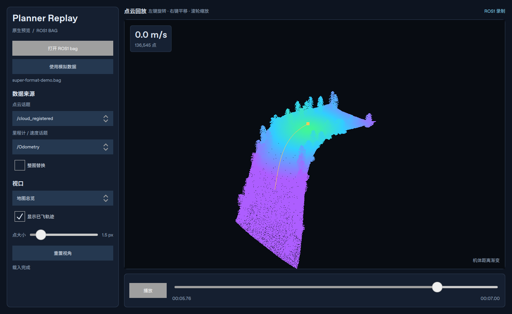

# Planner Replay Studio

Windows tools for replaying ROS1 SLAM point clouds and composing drone flight videos.

English · [简体中文](README_CN.md)

## Windows native preview

1. Open the [Windows builds](https://github.com/kevintjq/Planner-Replay-Studio/actions/workflows/native-windows.yml?query=branch%3Amain+is%3Asuccess) page and select the latest successful run on `main`.
2. Under **Artifacts**, download **PlannerReplayNative-Windows-x64** and extract the entire ZIP.
3. Double-click `PlannerReplayNative.exe`. Open a ROS1 `.bag` or choose the built-in demo.

The C++ / Qt Quick app requires an OpenGL 3.3-compatible graphics driver. It runs without Python, Tk or ROS. [Native build and usage guide](native/README.md)

## Choose a workspace

| | Native preview | Video composition workspace |
| --- | --- | --- |
| Launch | `PlannerReplayNative.exe` | [`Start_Planner_Replay.cmd`](Start_Planner_Replay.cmd), with Python 3.10+ and Tcl/Tk |
| Replay | `PointCloud2`, accumulated or replaced maps, distance colors, flown path and `Odometry` speed | Multi-view replay, TF and selectable overlays for EGO and SUPER |
| Editing and export | Play, seek and inspect point clouds | Multi-video sync, timed overlays, motion-ghost stills and 1080p/60 fps export |

For filming and editing, see the [video composition guide](docs/studio.md).

## Repository layout

| Path | Contents |
| --- | --- |
| [`native/`](native/) | C++ / Qt Quick desktop app, ROS1 bag reader and native tests |
| [`src/slam_fpv/`](src/slam_fpv/) | Python video composition workspace and CLI |
| [`tests/`](tests/) | Python workspace tests |
| [`docs/`](docs/) | User guides, screenshots and [validation notes](docs/VALIDATION.md) |
| [`examples/`](examples/) | ROS1 bridge, extrinsics template and bag validation |

[MIT License](LICENSE)
