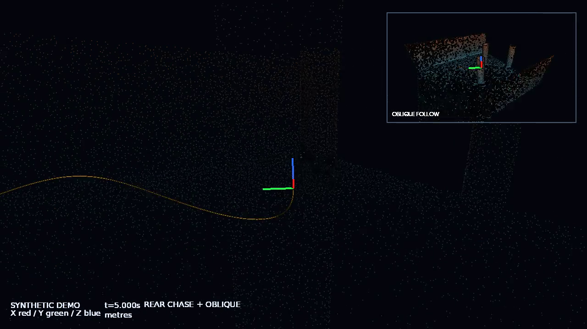

# SLAM FPV Renderer

Turn ROS1 SLAM point clouds into a rear-follow view with a high oblique inset. Export MP4 or PNG and optionally add movable flight footage.

[简体中文](README_CN.md) · [Demo](docs/synthetic-demo.mp4) · [Validation](docs/VALIDATION.md)



## Windows desktop

Install 64-bit Python 3.10+ with Tcl/Tk, clone the repository, then double-click [Start_SLAM_FPV.cmd](Start_SLAM_FPV.cmd). The first launch installs dependencies and needs Internet access.

1. Open a ROS1 `.bag`, select PointCloud2 and Odometry or TF, then set the export interval.
2. Add multiple flight videos in the Layers tab. Edit the trim, crop, alignment, width and opacity of each video independently. Swap any clip or use it as a full-screen backdrop beneath the cloud. Use matching events as alignment anchors.
3. Add timed captions or a speed gauge. Drag annotation handles to change their visible intervals and scrub the timeline to preview. Times are relative to the first cloud. The gauge estimates 3D speed in m/s from world-frame poses.
4. Drag overlays directly in the preview. Use + View to add movable, resizable oblique, left-follow, or right-follow insets. All views show TF axes and all insets have transparent backgrounds. Export MP4 or PNG at 1080p and 60 fps by default. Automatic encoding tests NVENC and falls back to CPU H.264.

The desktop defaults to an unlit SLAM view with a fixed world-height palette. Set voxel size to `0` to preserve raw points up to the configured point limit, or select native RGB for colorized clouds.

## CLI

```powershell
.\.venv\Scripts\slam-fpv.exe inspect run.bag
.\.venv\Scripts\slam-fpv.exe bag run.bag --output run.mp4 --cloud-topic /cloud_registered --odom-topic /Odometry --world camera_init --body body
.\.venv\Scripts\slam-fpv.exe bag --help
```

For TF, use `--pose-source tf` and record `/tf` and `/tf_static`. For live ROS1 or ROS-based replay, use [the bridge](examples/ros1_bridge.py) and `slam-fpv listen --help`.

MIT license. See [LICENSE](LICENSE).
