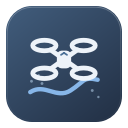
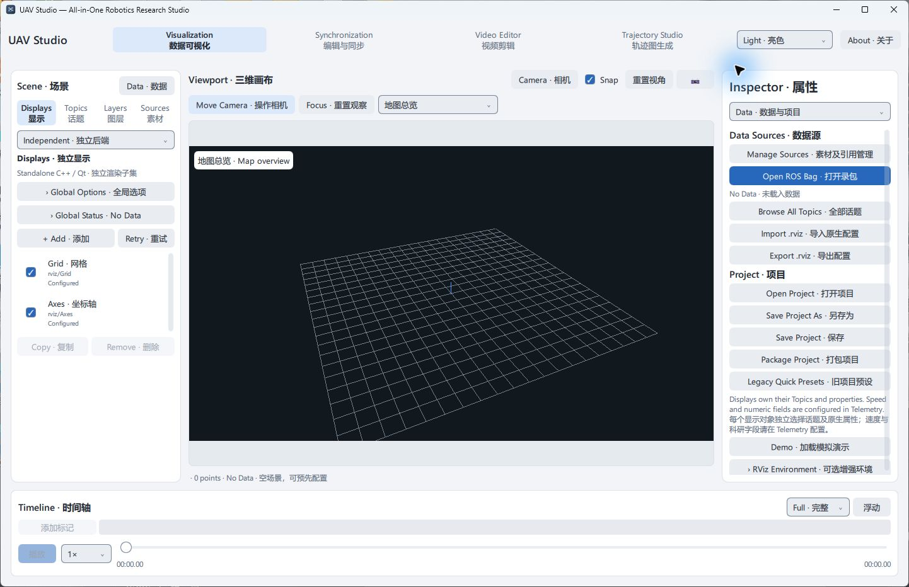
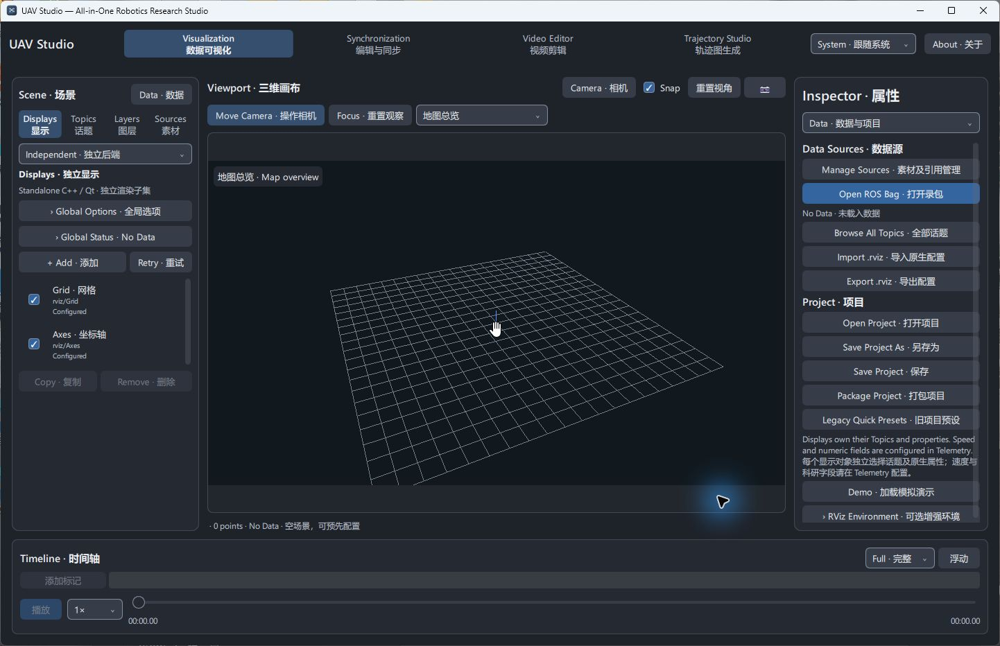
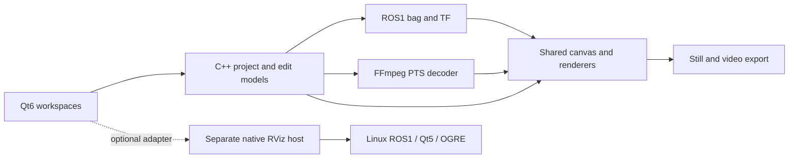

<p align="center"></p>
<h1 align="center">UAV Studio</h1>
<p align="center">All-in-One Robotics Research Studio</p>
<p align="center">C++ / Qt · ROS visualization · Flight video editing · Publication figures</p>
<p align="center">
  
  
  <a href="LICENSE"></a>
</p>
<p align="center">English · <a href="README_CN.md">简体中文</a></p>

## Overview

UAV Studio combines ROS1 replay, multi-view visualization, synchronized flight footage, a free canvas, video editing and scientific image export in four workspaces: **Visualization**, **Synchronization**, **Video Editor**, and **Trajectory Studio**. The active application runs in C++ / Qt without a Python runtime dependency.

**v1.0.0 Core Release.** The [v1 core scope](docs/V1_CORE_RELEASE_SCOPE_CN.md) focuses on four usable workflows, synchronization, editing and export. Advanced analysis, AR and automation continue in later PRs. Verified workflows, package validation and remaining limits are recorded in the [acceptance matrix](docs/REBUILD_ACCEPTANCE_CN.md) and [changelog](docs/NATIVE_CHANGELOG.md).

## Highlights

- ROS1 replay, actual Topic/field inspection, TF-aware cameras and `.rviz` preservation, with explicit unsupported-data diagnostics.
- Light, Dark and System through shared semantic tokens; scene backgrounds and output colors remain independent.
- A shared C++ canvas for Video Editor and Trajectory Studio, with separate workspace state, layers, transforms, timelines and undo/redo.
- Integer source PTS and rational time bases for video frames, with offset and two-anchor linear drift mapping.
- Shared video/frame rendering and fixed-camera UAV motion composites, with manual Keep/Erase masks and sample exclusions.

These describe implementation paths, not certification of every configuration.

## Workspaces

| Workspace | Core purpose | Typical workflow |
| --- | --- | --- |
| Visualization | ROS replay, Displays/Groups, `.rviz`, TF and cameras | Open data or an empty scene, configure Displays and arrange views |
| Synchronization | Sources, Topic/fields, curves and time alignment | Align footage to replay events and inspect real speed data |
| Video Editor | Free canvas, multiple views/clips, timeline, text/audio and gauges | Arrange layers, edit clips, save a project and export images/video |
| Trajectory Studio | Real UAV composites, trajectories, endpoints and annotations | Track a UAV, correct masks, select samples and export a composite |

## Gallery

Real GUI captures from the core acceptance build, with an empty Grid/Axes scene and no loaded user data. The dark appearance follows **System**; the scene background remains independently configured.

| Light | System → Dark |
| --- | --- |
|  |  |

[Screenshot provenance](assets/screenshots/README.md). Private flight footage and experimental geometry are not published.

## Architecture



The independent OpenGL renderer implements a defined subset. The optional host supplies actual installed RViz plugins and properties in a separate process. See the [shared canvas model](docs/SHARED_CANVAS_MODEL_CN.md), [PTS semantics](docs/PRECISE_VIDEO_SYNC_CN.md) and [backend matrix](docs/WINDOWS_BACKEND_COMPATIBILITY_CN.md).

## Installation

- [Download v1.0.0 — Windows x64 with Optional Native RViz](https://github.com/kevintjq/uav-studio/releases/download/v1.0.0/UAVStudio-1.0.0-Windows-x64-OptionalNativeRviz-Setup.exe).
- [Windows build workflow and CI artifacts](https://github.com/kevintjq/uav-studio/actions/workflows/native-windows.yml).
- [Native usage, build and CLI guide](native/README.md).

The installer bundles Qt, OpenCV, FFmpeg/FFprobe and the app-local C++ runtime. The download above also includes the optional Linux RViz host in a separate folder. Standalone Windows features require no ROS, WSL or Python; using the optional host requires a compatible external ROS/WSL environment, which this installer does not install. See [packaging](docs/BRANDING_MIGRATION_CN.md) and [Windows compatibility](docs/WINDOWS_BACKEND_COMPATIBILITY_CN.md).

### Build from source

```sh
git clone https://github.com/kevintjq/uav-studio.git
cd uav-studio
```

Use CMake 3.22+, a C++20 compiler, Qt 6.8+ with Multimedia/SVG/TIFF support, OpenCV 4.8+ with tracking/video I/O, BZip2, LZ4, yaml-cpp and a shared FFmpeg development package. Follow the [native build guide](native/README.md) or the [Windows dependency/build recipe](.github/workflows/native-windows.yml); NSIS is also needed for an installer. Build and deploy the same FFmpeg ABI. Legacy Python modules and developer-only test tools do not enter the native application runtime.

## Quick Start

1. **Load data.** Open a ROS1 `.bag`, a new `.uavstudio` project or an existing `.slamfpv` project. Choose actual point-cloud, pose and speed topics. Import `.rviz` to retain display configuration and review unsupported plugins or missing TF diagnostics.
2. **Arrange views.** Choose the main camera, a TF target and additional independent views. Place video, image, text and speed-meter layers on the shared canvas; edit their intervals and transitions on the timeline. Scene backgrounds and export colors remain independent of the application theme.
3. **Align footage.** Import multiple clips, set trim ranges and synchronization anchors, then check a common event in replay and video. The shared FFmpeg decoder selects source frames by PTS; one anchor corrects offset and two also correct linear drift.
4. **Edit and review.** Use the full, compact, mini or optional floating timeline. Track-specific trim, split, exclusion and undo/redo preserve the project. Light, Dark and System use one appearance manager and save the preference.
5. **Export.** Use the preview camera button or **Ctrl+Shift+E** for a still. Export the canvas, selected view/layers, separate views or keyframe batches; video export shares the full-resolution scene composition. Save or package the project to continue editing with its referenced media.
6. **Compose a UAV trail.** In Trajectory Studio, set a short start/end range and select the UAV in a fixed-camera source. Inspect the source/mask/foreground, use **Keep/Erase** to correct edges, and exclude overlapping or occluded samples. Style the trail and endpoints, then save the project and export. Reopening restores these edits and rebuilds the saved short range.

## Usage

| Task | Guide and current evidence |
| --- | --- |
| Desktop operation, save/portable media and CLI | [Native guide](native/README.md) |
| Frame/view/layer export, batches and panels | [Frame requirements](docs/FRAME_EXPORT_REQUIREMENTS_CN.md) · [Trajectory export](docs/TRAJECTORY_FRAME_EXPORT_CN.md) |
| Camera follow and TF conventions | [Camera behavior](docs/CAMERA_FOLLOW_CN.md) |
| Shared layers, transforms, source references and copy/paste | [Canvas model](docs/SHARED_CANVAS_MODEL_CN.md) · [Canvas acceptance](docs/UNIFIED_CANVAS_ACCEPTANCE_CN.md) |
| Source timestamps and image/video agreement | [PTS synchronization](docs/PRECISE_VIDEO_SYNC_CN.md) |
| Real masks and manual correction | [Foreground progress](docs/FOREGROUND_ACCEPTANCE_PROGRESS_CN.md) |
| Speed data, units and gauge rendering | [Speed backend](docs/SPEED_METER_BACKEND_CN.md) · [Gauge renderer](docs/SPEED_GAUGE_RENDERER_CN.md) |

CLI examples share the native data/rendering paths; GUI rendering may open a render window:

```sh
uav-studio-cli inspect recording.bag
uav-studio-cli export project.uavstudio --start 1.5 --output still.png
uav-studio-cli export project.uavstudio --start 1.5 --seconds 4 --output flight.mp4
```

The linked guides record actual GUI, real-data and file-output evidence separately from regression fixtures. See the acceptance matrix for the current workflow status.

## Compatibility

| Core area | Current implementation and boundaries |
| --- | --- |
| Windows standalone | C++/Qt6 with bundled dependencies; ROS/WSL/Python are not mandatory |
| ROS replay | ROS1 uncompressed/BZ2/LZ4 bags, PointCloud2, pose/TF, EGO/SUPER paths, goals and corridors; missing data and TF are reported |
| RViz configuration | Original YAML and unknown fields are preserved; untouched exports retain original bytes. The shared main canvas renders a supported display subset, not every native RViz plugin |
| Native RViz backend | Optional separate Linux ROS1 Noetic/Qt5/librviz/OGRE host. 33 installed Display classes have structural/property/configuration evidence; real-data rendering covers the listed subset. This does not imply all-plugin compatibility. Strict-history preview is capped at 4Hz. [Per-plugin matrix](docs/RVIZ_COMPATIBILITY_MATRIX_CN.md) |
| TF and multiple cameras | Standalone renderer: independent TF targets, follow modes, lag/smoothing and optical-axis convention. Native RViz: actual installed camera-plugin properties and Target Frame; the standalone follow-lag/smoothing controls are unavailable. [Behavior and acceptance](docs/CAMERA_FOLLOW_CN.md) |
| Image/video output | PNG/JPG/TIFF/PDF/SVG and MP4 paths; current composite limits: 8192 per side / 40MP for stills, 3840×2160 for video. Native scenes currently require opaque output; GPU tiling is pending |
| Vector output | Supported scientific text/shapes and trajectory primitives can remain vector. Video/point clouds/native scenes embed raster content; full scene panels are not advertised as pure vector |
| Motion composites | Fixed-camera tracking, interval/count/manual sampling, Keep/Erase correction, per-frame opacity, exclusions, undo/redo and source-quality export. A reviewed real sample produced a usable multi-UAV candidate after manual correction; netting and foliage can require repair. Hidden parts are not reconstructed |

ROS2 is not an implemented backend. Preserving unknown `.rviz` fields does not add their rendering support. Automatic foreground masks can contain residue or fail around occlusions; inspect and correct them before export. Detailed boundaries are in the [Windows/backend matrix](docs/WINDOWS_BACKEND_COMPATIBILITY_CN.md), [RViz matrix](docs/RVIZ_COMPATIBILITY_MATRIX_CN.md) and [foreground guide](docs/FOREGROUND_ACCEPTANCE_PROGRESS_CN.md).

## Roadmap

These checkboxes track delivery, not partial implementation. Advanced tasks proceed in independent branches/PRs; working code and earlier requirements are retained. The [v1 scope](docs/V1_CORE_RELEASE_SCOPE_CN.md) defines the necessary workflows for this release and the follow-up work.

### v1.0.0 Core Release

- [x] Verify the necessary four-workspace GUI flows, saved Light/Dark/System appearance, inline controls and empty-scene behavior.
- [x] Verify representative Display/property, `.rviz`, TF and multiple-view workflows with available real data and scoped native RViz comparison. Ecosystem-specific data gaps remain disclosed in the [scoped evidence](docs/V1_RVIZ_ECOSYSTEM_SCOPE_CN.md).
- [x] Verify source management, basic curves/speed statistics, accurate PTS/ROS alignment, representative seeking and project recovery.
- [x] Verify the necessary shared-canvas and timeline editing flows, layer transforms, undo/redo, video and frame output; retain text/audio/keyframe features and their detailed acceptance records. The actual GUI exported a 4K/60fps two-second H.264 clip.
- [x] Verify a real three-UAV composite with manual mask correction, sampling/exclusions, editable trail/endpoints and 4K frame output; disclose the source clip's remaining occlusion.
- [x] Complete the necessary workflows, package dependency and local installation/safe-upgrade checks; provide an installer, real screenshots and disclosed limitations. The final payload passed 57 installation/runtime checks, the upgrade transaction suite passed 43, and a complete 0.1.1 → 1.0.0 same-path upgrade passed 36, with their distinct scopes recorded in [validation](docs/VALIDATION.md).

### Trajectory Analysis

- [ ] APE/RPE/RMSE with genuine ground truth, units, intervals and alignment.
- [ ] Advanced multi-experiment statistics, error plots and trajectory/data analysis.

### Advanced Visualization

- [ ] Real-footage AR trajectory fusion and advanced flight corridors.
- [ ] Real-data/rendering acceptance for native/default and third-party plugins outside the v1 ecosystem scope, with unverified states disclosed; continued rendering optimization.

### Intelligent Processing

- [ ] Automatic event recognition and attitude/event sampling.
- [ ] Advanced tracking and foreground-segmentation optimization; basic clean foreground remains core.

### Publication & Automation

- [ ] Advanced paper layout and experiment-report generation.
- [ ] One-click asset packages and additional publication presets.

### Distribution & Data Sources

- [ ] In-app installer download with trusted-source and integrity verification.
- [ ] Automatic rollback after an upgrade.
- [ ] Multiple ROS bags and advanced data-source comparison.

## Contact & Updates

<!-- BEGIN PRODUCT METADATA -->
Maintained by **kevin** · [jq.tong0610@gmail.com](mailto:jq.tong0610@gmail.com)

Source version: **1.0.0** · [GitHub](https://github.com/kevintjq/uav-studio) · [Report an issue](https://github.com/kevintjq/uav-studio/issues/new/choose) · [Releases](https://github.com/kevintjq/uav-studio/releases) · [Roadmap](#roadmap)
<!-- END PRODUCT METADATA -->

Use **About → Check for Updates** for an optional asynchronous GitHub Releases check. Startup checks can be disabled; network failures do not prevent editing. Canonical stable `vX.Y.Z` releases are distinguished from historical preview products. Download installers from the release page; in-app downloads and automatic rollback remain planned. See the [upgrade guide](docs/WINDOWS_SAFE_UPGRADE_CN.md) for same-path installation, data preservation and validation status.

Bug, feature and compatibility reports have dedicated issue templates. Include the exact version/backend and reproduction steps; avoid sharing private recordings or sensitive experiment geometry.

## License & Acknowledgements

Project source is [MIT licensed](LICENSE). Qt, OpenCV, FFmpeg, compression/YAML libraries and optional RViz components retain their own licenses; see the [dependency notices](native/installer/THIRD_PARTY.md). Thanks to the Qt, ROS/RViz, OGRE, OpenCV and FFmpeg communities.

The [English](docs/studio.md) and [Chinese](docs/studio.zh-CN.md) legacy guides describe **Planner Replay Studio Full**. Existing `.slamfpv` project compatibility, legacy sources/tests and historical Git tags are retained. Keep local installer backups and old application/project directories until migration is checked; new installation does not delete them. Historical names and package identifiers remain where compatibility requires them.
