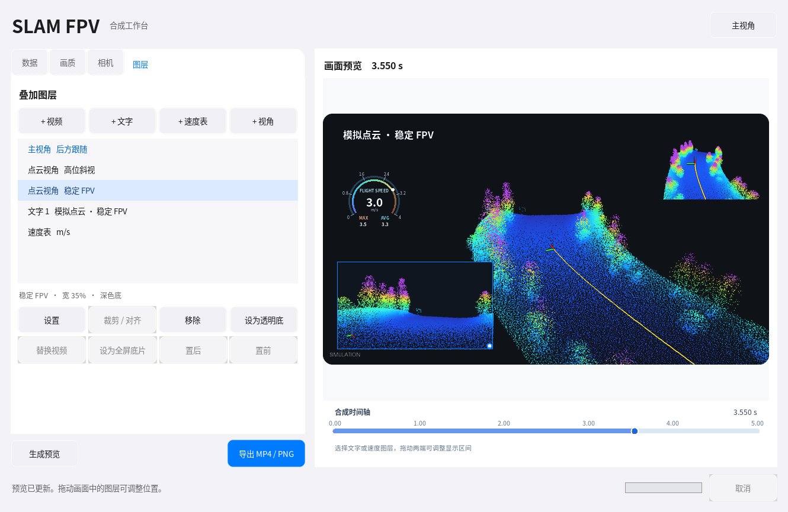

<h1 align="center">Planner Replay Studio</h1>

<p align="center">SLAM point clouds · Multi-video alignment · 60 fps export</p>

<p align="center">
  
  
  
  
</p>

<p align="center">English · <a href="README_CN.md">简体中文</a></p>

<p align="center">
  <a href="#quick-start">Quick start</a> ·
  <a href="#multi-video-alignment">Multi-video alignment</a> ·
  <a href="#inputs-and-overlays">Inputs and overlays</a> ·
  <a href="#timeline">Timeline</a> ·
  <a href="#save-and-export">Save and export</a>
</p>

---

A Windows workspace for composing multi-view videos from ROS1 SLAM point clouds, poses and flight footage.



| Feature | Description |
| --- | --- |
| Point-cloud views | 12 presets, including stabilized FPV, chase and oblique views |
| Multiple videos | Trim, align and place each clip as a backdrop or picture-in-picture |
| Optional overlays | Planned paths, goals, safety corridors, camera FOV, latest LiDAR scan, speed gauge and timed captions |

## Quick start

1. Install 64-bit Python 3.10 or newer with Tcl/Tk.
2. Clone the repository and double-click [Start_Planner_Replay.cmd](Start_Planner_Replay.cmd). The first launch downloads dependencies.
3. Open a ROS1 `.bag` under **Data** or choose **Use simulated data**. Pick views and layers, then generate a preview.

## Multi-video alignment

1. With a bag open, import flight footage to open the first clip's alignment window.
2. Find the same action in both panes and select **Align these frames**.
3. Open **Fine tune** for the second anchor, motion candidates, loop review and midpoint check.

All clips use the same bag timeline and keep their own trim ranges and anchors. One anchor sets the time offset. Two also correct linear clock drift.

## Inputs and overlays

| Data | ROS topic type |
| --- | --- |
| Map and pose | `PointCloud2` + `Odometry` or TF |
| Planned path | `Path`, `Marker[Array]`, SUPER colored `ARROW` segments or EGO `Bspline` |
| Goal | SUPER `visualization/goal`, EGO `goal_point`, `PoseStamped` or `PointStamped` |
| Safety corridor | `Marker` or `MarkerArray` with line strips, line lists, triangles or cubes |
| Camera FOV | `CameraInfo` and optical-frame TF |
| Latest LiDAR scan | `PointCloud2`, Livox `CustomMsg` or `LaserScan` |
| Speed gauge | 3D linear speed in m/s from `Odometry`, `TwistStamped` or `Twist` |

Choose a speed topic under **Data → Data source**. Automatic selection prefers odometry for the current vehicle. The gauge shows a dash when no valid reading is available. Stamped messages use header time, and `Twist` uses bag recording time.

Topics and frames are detected automatically and can be changed in the dropdowns. Enable data under **Spatial overlays**, then choose what each view shows. Use **Lines and markers** to set actual path, planned path and TF widths independently, and to size the solid goal dot. The preview reports scan source, age and missing data.

SUPER defaults to `visualization/exp_traj` and `visualization/exp_sfc` when present. EGO prefers `planning/bspline` and can also use `optimal_list`. EGO B-splines default to `world`, which can be changed below the trajectory topic. Goals and trajectories switch independently.

Scroll over a point-cloud view to zoom it. Each view also has a camera zoom percentage that is saved with the project.

Under **Data → Spatial overlays**, keep automatic detection or select any topic in the bag. Each layer reports its status at the preview position and flags incompatible message types.

## Timeline

- Add a PNG or JPG from **Layers**. Drag to position or resize it in the preview. Drag either timeline edge or double-click the layer to set exact display times. PNG alpha is preserved.
- Use **Play** for continuous proxy preview. With timeline focus, Space pauses or plays and arrow keys step one frame. Drag the playhead to scrub. Export retains the configured resolution and frame rate.
- Select a video and press S to split or Delete to remove the segment at the playhead. The clip menu offers the same actions. Cuts preserve the bag-time alignment and mute the selected source audio in removed ranges. Use Ctrl+Z / Ctrl+Y to undo or redo, and **Snap** to align to markers and segment edges.
- Click a purple layout marker to jump or drag it to change its time. Right-click a **Footage inset** marker to adjust its own size, position and 0–5 second transition.
- Select a layer, move the playhead and use **Shrink here** to start a 0.4-second transition. Drag the small window after the transition or right-click the green marker to set its destination and fine-tune the timing.
- Add a marker at the playhead with **+ Event**. Right-click it to rename or delete it. Click a marker or pick an event from the list to jump.
- Video, captions and the speed gauge have separate tracks. Drag an edge to trim, or drag the body of a video segment to move its visibility window on the aligned bag timeline. Enable previous-plan comparison to show a dashed grey path.
- Set a layout marker at the playhead to switch between the composition, full-screen point cloud, and full-screen footage. Click a purple marker to jump back to it.
- Keep the cloud layer transparent and add **Footage backdrop** then **Footage inset** markers for the same clip. The second marker starts a 0.4-second transition by default.

The default palette colors each point from green to purple by its 3D distance from the current vehicle position, including points retained from earlier frames. Select a SLAM cloud or a planner's `PointCloud2` map, such as EGO `grid_map/occupancy` or SUPER `rog_map/occ`. Known occupancy map topics default to **Replace map** and use bag recording time when the header timestamp is missing.

## Fixed-camera trajectory image

Open **Fixed-camera trajectory**, pick a starting frame and draw a box around the drone. Select or enter a sampling interval in video seconds, or use automatic spacing based on screen movement. Generate the silhouettes, then review and save the PNG. Leave the end blank to track to the end of the clip. Tracking stops if the target is lost.

## Save and export

| Format | Description |
| --- | --- |
| `.slamfpv` | Stores media paths, trims, anchors, event and layout markers, and export settings. Moved media can be relinked. |
| MP4 | Defaults to 1080p at 60 fps with automatic NVIDIA NVENC or CPU H.264 encoding; optional single-track source audio and 0.5× / 0.25× playback |
| PNG | Enable **Transparent canvas** to export an alpha channel |

Choose **Export 1080p · 60 fps** for the default preset. Open **More settings** to export PNG or choose resolution, frame rate, encoder, source audio and slow motion.

<details>
<summary>Command line</summary>

```powershell
.\.venv\Scripts\planner-replay.exe inspect run.bag
.\.venv\Scripts\planner-replay.exe bag run.bag --output captures/run.mp4 --cloud-topic /cloud_registered --odom-topic /Odometry --world camera_init --body body
.\.venv\Scripts\planner-replay.exe bag --help
```

[ROS1 live bridge](examples/ros1_bridge.py) · [Validation](docs/VALIDATION.md)

</details>

## License

[MIT License](LICENSE)
