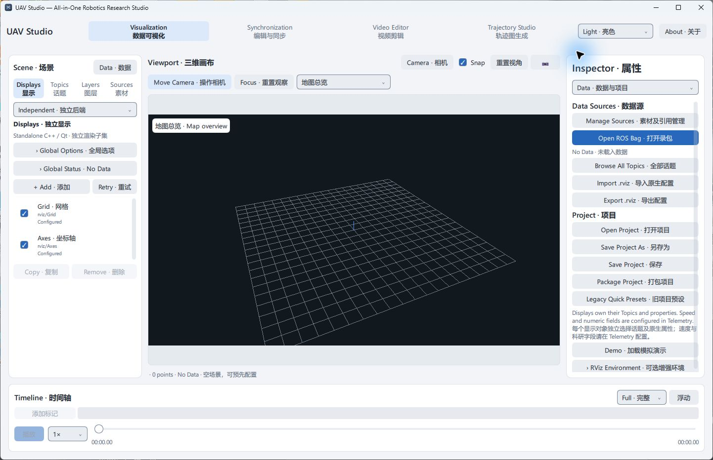
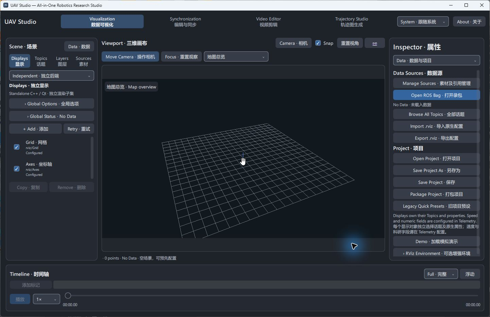
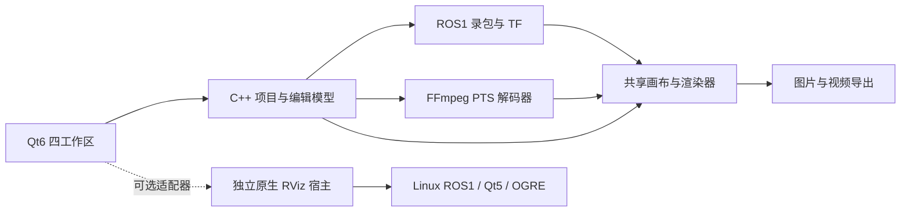

<p align="center"></p>
<h1 align="center">UAV Studio</h1>
<p align="center">All-in-One Robotics Research Studio · 无人机科研工作站</p>
<p align="center">C++ / Qt · ROS 可视化 · 实飞视频剪辑 · 科研配图</p>
<p align="center">
  
  
  <a href="LICENSE"></a>
</p>
<p align="center"><a href="README.md">English</a> · 简体中文</p>

## Overview · 项目概览

UAV Studio 将 ROS1 回放、多视角可视化、实飞同步、自由画布、视频剪辑和图片导出整合到四个工作区：**Visualization（数据可视化）**、**Synchronization（编辑与同步）**、**Video Editor（视频剪辑）**和 **Trajectory Studio（轨迹图生成）**。当前应用使用 C++ / Qt，无 Python 运行依赖。

**v1.0.0 核心正式版。** [v1 核心范围](docs/V1_CORE_RELEASE_SCOPE_CN.md)聚焦四工作区可用流程、同步、编辑及导出。高级分析、AR 和自动化继续在后续 PR 中完成。已验证流程、安装包验收与剩余限制见[验收矩阵](docs/REBUILD_ACCEPTANCE_CN.md)和[变更记录](docs/NATIVE_CHANGELOG.md)。

## Highlights · 功能概览

- ROS1 回放、真实 Topic/字段浏览、TF 相机与 `.rviz` 保留；不支持的数据明确诊断。
- Light、Dark、System 共用语义 Design Tokens，场景背景和输出配色独立设置。
- Video Editor 与 Trajectory Studio 共用 C++ 画布，分别保存工作区状态，提供图层、变换、时间轴及撤销/重做。
- 视频源帧使用整数 PTS 和有理数 time_base，提供偏移及双锚点线性漂移映射。
- 共享视频/单帧渲染及固定机位无人机拖影，提供 Keep/Erase 手工蒙版和采样排除。

这些是实际实现路径，不代表所有配置已经认证。

## Workspaces · 四个工作区

| 工作区 | 核心用途 | 常用流程 |
| --- | --- | --- |
| Visualization | ROS 回放、Displays/Groups、`.rviz`、TF 与相机 | 打开数据或空场景、配置 Display、安排视角 |
| Synchronization | 素材、Topic/字段、曲线与时间对齐 | 对齐录包和视频事件、检查真实速度数据 |
| Video Editor | 自由画布、多视角/片段、时间轴、文字/音频与仪表 | 排列图层、剪辑片段、保存项目及导出图片/视频 |
| Trajectory Studio | 真实无人机拖影、轨迹、端点及标注 | 跟踪无人机、修正蒙版、选择采样并输出合成图 |

## Gallery · 真实运行展示

核心验收构建的真实 GUI 实拍，画面为空白 Grid/Axes 场景，未加载用户数据。深色界面使用 **System（跟随系统）**，场景背景独立设置。

| Light · 亮色 | System → Dark · 跟随系统深色 |
| --- | --- |
|  |  |

[截图来源记录](assets/screenshots/README.md)。用户实飞视频及实验几何不公开。

## Architecture · 项目架构



独立 OpenGL 渲染器实现明确的显示子集，可选宿主在独立进程提供实际安装的 RViz 插件和属性。详见[共享画布模型](docs/SHARED_CANVAS_MODEL_CN.md)、[PTS 语义](docs/PRECISE_VIDEO_SYNC_CN.md)及[后端矩阵](docs/WINDOWS_BACKEND_COMPATIBILITY_CN.md)。

## Installation · 安装

- [下载 v1.0.0 — Windows x64（含可选原生 RViz 宿主）](https://github.com/kevintjq/uav-studio/releases/download/v1.0.0/UAVStudio-1.0.0-Windows-x64-OptionalNativeRviz-Setup.exe)。
- [Windows 构建工作流与 CI 产物](https://github.com/kevintjq/uav-studio/actions/workflows/native-windows.yml)。
- [原生使用、构建与命令行说明](native/README.md)。

安装器包含 Qt、OpenCV、FFmpeg/FFprobe 和应用本地 C++ 运行库；上述下载还在独立目录中附带可选 Linux RViz 宿主。Windows 独立功能不要求 ROS、WSL 或 Python；启用可选宿主需要兼容的外部 ROS/WSL 环境，安装器不会安装该外部环境。详见[品牌与打包](docs/BRANDING_MIGRATION_CN.md)及 [Windows 兼容说明](docs/WINDOWS_BACKEND_COMPATIBILITY_CN.md)。

### 从源码构建

```sh
git clone https://github.com/kevintjq/uav-studio.git
cd uav-studio
```

需要 CMake 3.22+、C++20 编译器、Qt 6.8+（Multimedia/SVG/TIFF）、OpenCV 4.8+（tracking/video I/O）、BZip2、LZ4、yaml-cpp 及共享 FFmpeg 开发包。按[原生构建指南](native/README.md)或 [Windows 依赖/构建流程](.github/workflows/native-windows.yml)配置；制作安装包另需 NSIS，FFmpeg 构建与部署使用同一 ABI。旧 Python 模块及开发测试工具不进入原生运行依赖。

## Quick Start · 快速开始

1. **打开数据。**载入 ROS1 `.bag`、新 `.uavstudio` 项目或现有 `.slamfpv` 项目，选择真实点云、位姿及速度话题。导入 `.rviz` 后检查未支持插件、缺少 TF 等诊断。
2. **组织视角。**设置主相机、TF 目标与独立附加机位，在共享自由画布中安排视频、图片、文字和速度表，通过时间轴编辑显示区间与过渡。三维背景和输出配色独立于软件亮暗主题。
3. **对齐实飞。**导入多路素材，设置裁剪及同步锚点，复核录包与视频中的共同事件。共享 FFmpeg 解码器按源 PTS 选择画面；单锚点校正偏移，双锚点还能校正线性漂移。
4. **剪辑检查。**使用完整、紧凑、迷你或主动开启的浮动时间轴。分轨裁剪、分割、排除及撤销/重做随项目保留；统一外观管理器提供 Light、Dark、System 并保存偏好。
5. **独立导出。**点击预览相机按钮或按 **Ctrl+Shift+E** 保存图片。可导出画布、选中视角/图层、各视角及批量关键帧；视频共用完整分辨率场景合成。保存或打包项目及引用素材后可继续编辑。
6. **制作无人机拖影。**在 Trajectory Studio 设置较短的起止区间，框选固定机位源中的无人机。检查原图/蒙版/前景，用 **Keep/Erase** 精修边缘，排除重叠或遮挡采样，再编辑轨迹/端点、保存项目并导出。重开会恢复这些编辑，并重建保存的短区间。

## Usage · 使用与证据

| 操作 | 指南及当前证据 |
| --- | --- |
| 桌面操作、保存/素材打包及 CLI | [原生指南](native/README.md) |
| 画面/视角/图层、批量与多联图输出 | [单帧需求](docs/FRAME_EXPORT_REQUIREMENTS_CN.md) · [轨迹导出](docs/TRAJECTORY_FRAME_EXPORT_CN.md) |
| 相机跟随及 TF 约定 | [相机行为](docs/CAMERA_FOLLOW_CN.md) |
| 公共图层、变换、素材引用及复制粘贴 | [画布模型](docs/SHARED_CANVAS_MODEL_CN.md) · [画布验收](docs/UNIFIED_CANVAS_ACCEPTANCE_CN.md) |
| 源时间戳及图片/视频一致性 | [PTS 同步](docs/PRECISE_VIDEO_SYNC_CN.md) |
| 真实蒙版及手动修正 | [前景进度](docs/FOREGROUND_ACCEPTANCE_PROGRESS_CN.md) |
| 速度数据、单位及仪表盘渲染 | [速度后端](docs/SPEED_METER_BACKEND_CN.md) · [仪表盘渲染](docs/SPEED_GAUGE_RENDERER_CN.md) |

CLI 复用原生数据/渲染路径，GUI 渲染可能打开渲染窗口：

```sh
uav-studio-cli inspect recording.bag
uav-studio-cli export project.uavstudio --start 1.5 --output still.png
uav-studio-cli export project.uavstudio --start 1.5 --seconds 4 --output flight.mp4
```

链接文档分别记录实际 GUI、真实数据、输出文件及回归夹具证据；当前工作流状态见验收矩阵。

## Compatibility · 兼容范围

| 核心模块 | 当前实现与边界 |
| --- | --- |
| Windows 独立运行 | C++/Qt6 配合包内依赖，不强制 ROS/WSL/Python |
| ROS 回放 | ROS1 无压缩/BZ2/LZ4 bag、PointCloud2、位姿/TF、EGO/SUPER 轨迹、目标和走廊；缺少数据或 TF 明确报告 |
| RViz 配置 | 保留完整源 YAML 及未知字段，未编辑导出保持原字节。共享主画布只渲染已支持的 Display 子集，不能视作全部原生插件 |
| 原生 RViz 后端 | 可选的独立 Linux ROS1 Noetic/Qt5/librviz/OGRE 宿主；33个已安装 Display 类有结构/属性/配置证据，真实数据渲染覆盖矩阵中的明确子集，不等于全插件兼容。严格历史预览上限4Hz。[逐插件矩阵](docs/RVIZ_COMPATIBILITY_MATRIX_CN.md) |
| TF 与多机位 | 独立渲染后端可配置 TF 目标、跟随模式、滞后/平滑及光学轴；原生 RViz 使用已安装相机插件实际提供的属性/Target Frame，暂不提供独立后端的滞后/平滑控制。[行为与验收](docs/CAMERA_FOLLOW_CN.md) |
| 图片/视频输出 | PNG/JPG/TIFF/PDF/SVG 和 MP4 路径；完整合成静图当前单边8192/4000万像素，视频3840×2160。原生场景目前不透明，GPU分块待完成 |
| 矢量输出 | 已支持科研文字/形状及轨迹图元可保留矢量；视频/点云/原生场景嵌入位图，完整场景面板不声称纯矢量 |
| 无人机拖影图 | 固定机位跟踪、间隔/数量/手动采样、Keep/Erase 精修、单帧透明度、排除、撤销/重做及源质量输出；已审看的真实素材经手修形成可用多实例候选图，球网和树叶附近可能需要修补，不恢复被遮挡的机身 |

ROS2 后端未实现；保留未知 `.rviz` 字段不会增加对应渲染能力。自动前景在遮挡附近可能残留背景或提取失败，导出前请检查和修正。详细边界见 [Windows/后端矩阵](docs/WINDOWS_BACKEND_COMPATIBILITY_CN.md)、[RViz 矩阵](docs/RVIZ_COMPATIBILITY_MATRIX_CN.md)及[前景说明](docs/FOREGROUND_ACCEPTANCE_PROGRESS_CN.md)。

## Roadmap · 后续计划

勾选项代表交付，不代表部分代码已经存在。高级任务采用独立分支/PR，保留有效代码及此前需求；[v1 范围](docs/V1_CORE_RELEASE_SCOPE_CN.md)明确本次必要流程和后续工作。

### v1.0.0 Core Release · 核心发行

- [x] 完成必要的四工作区 GUI 流程、Light/Dark/System 偏好保存、内联控件及空场景验收。
- [x] 使用可取得的真实数据完成代表性 Display/属性、`.rviz`、TF 和多视角流程及限定范围的原生 RViz 对照；具体生态缺少的数据在[范围证据](docs/V1_RVIZ_ECOSYSTEM_SCOPE_CN.md)中披露。
- [x] 完成素材管理、基础曲线/速度统计、精确 PTS/ROS 对齐、代表性跳转及项目恢复验收。
- [x] 完成必要的共享画布、时间轴编辑、图层变换、撤销/重做、视频及单帧输出验收；保留文字、音频和关键帧功能及其详细验收记录。实际 GUI 已导出 4K/60fps、两秒 H.264 短片。
- [x] 完成真实三无人机手修前景合成、采样/排除、可编辑轨迹/端点及 4K 图片输出验收，披露源视频仍存在的遮挡。
- [x] 完成必要流程、安装包依赖完整及本机安装/安全升级检查，提供安装包、真实截图和明确限制。最终载荷安装/运行57项、升级事务43项、完整0.1.1 → 1.0.0载荷同路径升级36项通过，各自范围记录在[实际验收](docs/VALIDATION.md)。

### Trajectory Analysis · 轨迹分析

- [ ] 基于真实 Ground Truth 的 APE/RPE/RMSE，明确单位、区间及对齐。
- [ ] 多实验高级统计、误差图及轨迹/数据分析。

### Advanced Visualization · 高级可视化

- [ ] 实拍 AR 轨迹融合及高级飞行走廊。
- [ ] v1核心生态以外原生默认/第三方插件的实数据与渲染验收，明确披露未验证状态；持续渲染优化。

### Intelligent Processing · 智能处理

- [ ] 自动事件识别及姿态/事件采样。
- [ ] 高级跟踪和前景分割优化；基础干净前景仍为核心。

### Publication & Automation · 出版与自动化

- [ ] 高级论文自动排版及实验报告生成。
- [ ] 一键素材包与更多出版预设。

### Distribution & Data Sources · 发行与数据源

- [ ] 应用内下载安装包，校验可信来源与完整性。
- [ ] 升级后的自动回滚。
- [ ] 多 ROS Bag 导入及高级多数据源对比。

## Contact & Updates · 联系与更新

<!-- BEGIN PRODUCT METADATA -->
开发者：**kevin** · [jq.tong0610@gmail.com](mailto:jq.tong0610@gmail.com)

源码版本：**1.0.0** · [GitHub](https://github.com/kevintjq/uav-studio) · [问题反馈](https://github.com/kevintjq/uav-studio/issues/new/choose) · [发行与更新](https://github.com/kevintjq/uav-studio/releases) · [更新路线图](#roadmap--后续计划)
<!-- END PRODUCT METADATA -->

通过 **About → Check for Updates（检查更新）** 可异步查询 GitHub Releases，启动检测可以关闭，网络异常不影响编辑。仅识别规范的稳定版 `vX.Y.Z`，与历史预览产品区分。安装包从发行页下载，应用内下载及自动回滚保留后续计划；同路径安装、数据保全及验证状态见[升级指南](docs/WINDOWS_SAFE_UPGRADE_CN.md)。

Bug、功能建议及兼容性报告有独立模板。请提供精确版本、后端及复现步骤，避免提交私人录包或敏感实验几何。

## License & Acknowledgements · 许可与致谢

项目源码使用 [MIT 许可证](LICENSE)。Qt、OpenCV、FFmpeg、压缩/YAML 库及可选 RViz 组件保留各自许可，详见[依赖说明](native/installer/THIRD_PARTY.md)。感谢 Qt、ROS/RViz、OGRE、OpenCV 和 FFmpeg 社区。

[中文](docs/studio.zh-CN.md)及[英文](docs/studio.md)旧指南描述 **Planner Replay Studio Full**。现有 `.slamfpv` 项目兼容、旧源码/测试及历史 Git 标签继续保留。迁移检查前保留本地安装包备份与旧程序/项目目录，新安装器不删除它们；必要的旧名称及包标识保持兼容。
