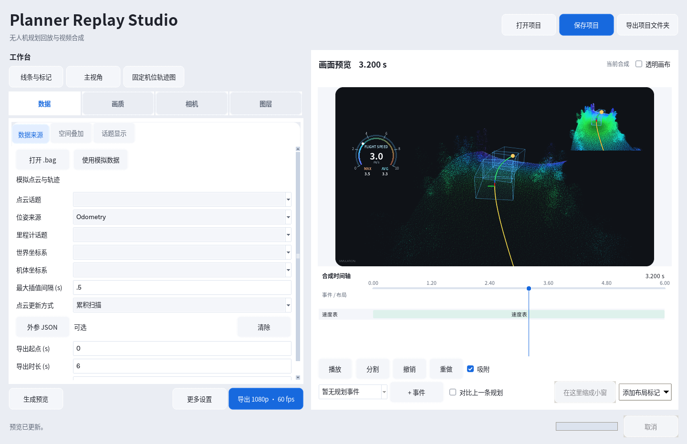

# 视频合成工作台

[项目首页](../README_CN.md) · [English](studio.md)



## 快速开始

[下载完整工作台 Windows EXE](https://github.com/kevintjq/Planner-Replay-Studio/releases/download/studio-v0.4.2/PlannerReplayStudio-Setup.exe)，安装后从开始菜单打开 **Planner Replay Studio Full**。

在「数据」打开 ROS1 `.bag`，或点「使用模拟数据」查看效果。选择机位和图层后点「生成预览」。

## 多路视频对齐

1. 打开 bag 后导入实拍，工作台会打开第一路视频的对齐窗口。其他路从「裁剪 / 对齐」打开。
2. 在左右两边找到同一个动作，点「对齐这两帧」保存。需要校正时钟漂移时，再到「精调」记录第二个锚点。
3. 「精调」还提供候选动作、循环核对和中段检查。

所有视频以同一份 bag 为时间基准，各自保留裁剪范围和锚点。一个锚点校正时间偏移，两个锚点还可校正线性时钟漂移。

## 输入与叠加

| 数据 | 话题或格式 |
| --- | --- |
| 地图与位姿 | `PointCloud2` + `Odometry` 或 TF |
| 规划轨迹 | `Path`、`Marker[Array]`、SUPER 彩色 `ARROW` 或 EGO `Bspline` |
| 目标点 | SUPER `visualization/goal`、EGO `goal_point`、`PoseStamped` 或 `PointStamped` |
| 安全走廊 | `Marker` 或 `MarkerArray`，支持折线、线段、三角面和立方体 |
| 相机 FOV | `CameraInfo` 与光学坐标系 TF |
| 雷达当前帧 | `PointCloud2`、Livox `CustomMsg` 或 `LaserScan` |
| 速度表 | `Odometry`、`TwistStamped` 或 `Twist` 的三维线速度，单位 m/s |

在「图层 → + 速度表」添加速度表，或选中已有速度表后点「设置」选择速度话题。自动识别优先使用同机体的里程计。无有效速度样本时显示「—」。带时间戳的话题按消息时间对齐，`Twist` 使用 bag 记录时间。

话题和坐标系自动识别，可从下拉列表更换。点云可选 SLAM 配准输出、EGO 的 `grid_map/occupancy` 或 SUPER 的 `rog_map/occ` 等 `PointCloud2` 话题。选择已识别的占据地图话题时默认「替换整图」。若该话题未填消息时间戳，使用 bag 的记录时间。

「机体距离渐变」每帧按点到当前机体的三维距离由绿到紫着色，已累积的点也会跟随机体移动更新颜色。后方跟随和高位斜视可显示黄色已飞轨迹与随位姿移动的 TF 三轴，FPV 保留三轴。可在「线条与标记」调整已飞轨迹、规划轨迹、TF 线宽和目标点直径。在「空间叠加」启用数据后，可在各视角选择显示的叠加项。

SUPER 优先识别 `visualization/exp_traj` 和 `visualization/exp_sfc`。EGO 优先识别 `planning/bspline`，也可选择 `optimal_list`。EGO B 样条使用默认 `world` 坐标系，可在轨迹话题下方更换。规划轨迹和目标点可分别关闭。

左侧「数据 → 空间叠加」列出 bag 的全部话题，保留自动识别。选中不兼容的话题时，对应图层会提示「类型不匹配」。各图层也会显示当前预览位置的数据状态。

预览时，将鼠标移到点云主画面或小窗上滚动即可拉近、拉远。各视角的设置里也可直接输入相机缩放比例，随项目保存。

## 话题显示与 RViz 导入

在「数据 → 话题显示」点「按话题添加」，按话题名或消息类型搜索。每项可以改名、选色、启用或停用，并选择是否只在主画面显示。主点云也可以隐藏。配置随项目保存，3D 显示同时用于预览和导出。

| 显示 | 支持内容 |
| --- | --- |
| 3D | 点云、LaserScan、Path、EGO B 样条、Marker / MarkerArray、位置与 TF。附加点云显示最近一帧 |
| 图像 | 查看常用 8 位 Image 及普通 JPEG / PNG CompressedImage |
| 消息字段 | 所有已录制话题均可查看字段。按录包时间取该时刻前最近一条，支持展开数组和自定义消息。无法解码时可查看原始字节 |

点「导入 .rviz」可以从 RViz / RViz2 配置读取固定坐标系、话题、显示名称、显隐与颜色。可在打开 bag 前导入。导入会替换话题显示列表，支持的 3D 图层直接显示。网格、RobotModel、插件窗口和视角布局等 RViz 专用设置不会导入。导入状态会列出跳过的项目和改用字段查看的项目。

## 时间轴

- 在「图层」点「+ 图片」导入 PNG 或 JPG 等图片。可在画面拖动位置和大小，在时间轴拖两端调整显示区间，或双击图层输入精确时间。PNG 保留透明通道。
- 点「播放」连续预览。时间轴聚焦后，空格播放或暂停，方向键逐帧。交互预览最高 1080p、30 fps，并使用设定的点数和体素。导出使用设定的分辨率和帧率。
- 选中视频并按 S 分割，按 Delete 删除播放头所在片段，或从片段右键菜单操作。裁剪、分割和删除保留原有同步，删除时在同一时间位置留空，原声同步静音。Ctrl+Z / Ctrl+Y 撤销或重做，「吸附」可对齐事件、布局和片段边缘。
- 点击紫色布局标记跳转，拖动标记调整时间。右键「实拍切到小窗」可单独调整该标记的尺寸、位置和 0–5 秒过渡时长。
- 选中图层，把播放头放在切换时刻，点「在这里缩成小窗」。默认平滑过渡 0.4 秒。过渡结束后直接拖动小窗，或右键绿色标记设置位置和精调。
- 点击「+ 事件」在播放头处打标记，右键改名或删除。点击标记即可跳转，也可从下拉列表跳到重规划或目标更新。
- 视频、图片、文字和速度表各占一轨。拖动片段两端裁剪，拖动视频片段中间能平移它的显示区间，仍按原有锚点取帧。勾选「对比上一条规划」可看灰色虚线。
- 把播放头放到切换时刻，从「添加布局标记」选择当前合成、点云全屏或一路实拍全屏。
- 同一段实拍先作底片再变小窗时，保留点云透明底，在对应时刻依次为同一路素材添加「实拍作底片（保留叠加）」和「实拍切到小窗」。小窗从第二个标记起平滑缩入，默认 0.4 秒。

## 固定机位轨迹图

1. 打开「固定机位轨迹图」，选择起始帧并框住无人机。可填写结束时间，留空则跟踪到片尾。
2. 点击「生成轨迹」。在右侧采样帧列表选中任一帧，可删除、恢复或按 Delete。调整不透明度滑块，或输入新的采样间隔（回车应用），无需重新跟踪。
3. 点击「保存轨迹 PNG」导出原视频分辨率。预览使用较小画面。跟踪中断时保留已跟踪部分。

轨迹编辑、图层设置、话题显示设置和导出设置在工作台内展开。

## 保存与导出

| 项目 | 说明 |
| --- | --- |
| `.slamfpv` | 保存素材路径、裁剪、锚点、事件与布局标记和导出参数，素材移动后可重新定位 |
| 项目文件夹 | 点击 **导出项目文件夹** 并给新文件夹命名。包含 `project.slamfpv`、`media`、`cache` 和 `exports` |
| MP4 | 默认 1080p、60 fps，自动选择 NVIDIA NVENC 或 CPU H.264；可选一路原声及 0.5× / 0.25× 慢放 |
| PNG | 勾选「透明画布」保留透明通道 |

搬迁或备份时复制整个文件夹，重新打开其中的 `project.slamfpv`。按 **保存项目** 会把新增素材复制进 `media`。导出视频和轨迹图时默认打开 `exports`，中间文件放进 `cache`，任务结束后清理。旧的单文件项目仍可打开并转换。

点「导出 1080p · 60 fps」选文件位置即可开始。「更多设置」可选择 MP4 或 PNG，并自定义分辨率、帧率、编码、原声和慢放。

<details>
<summary>命令行</summary>

```powershell
.\.venv\Scripts\planner-replay.exe inspect run.bag
.\.venv\Scripts\planner-replay.exe bag run.bag --output captures/run.mp4 --cloud-topic /cloud_registered --odom-topic /Odometry --world camera_init --body body
.\.venv\Scripts\planner-replay.exe bag --help
```

[ROS1 实时桥接](../examples/ros1_bridge.py) · [验证记录](VALIDATION.md)

</details>

## 许可证

[MIT License](../LICENSE)
